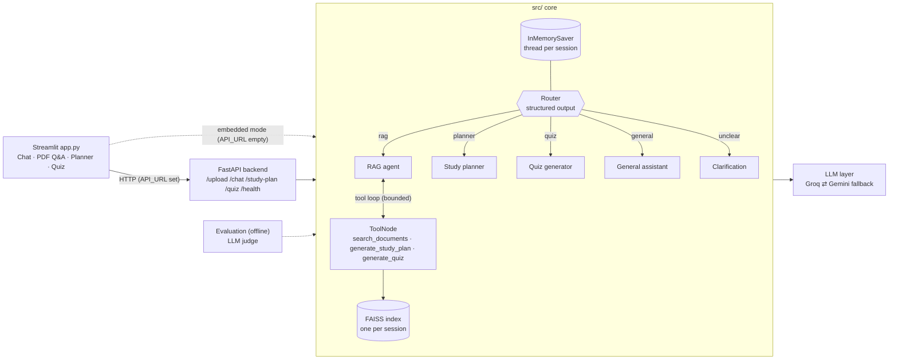

# 🎓 Agentic AI-Powered Student Assistant (RAG + LangGraph + LLMs)

A student assistant that answers questions from your own PDFs, explains academic topics, builds study plans and generates quizzes. It is built to be easy to read: simple modules, typed (Pydantic) outputs and tests for every layer.

**What it demonstrates:** Retrieval-Augmented Generation, LangGraph routing, LLM-driven tool calling, conversation memory, structured outputs, hallucination control, LLM-as-a-judge evaluation, a FastAPI backend and a Streamlit frontend.

## Features

| Feature | How it works |
| --- | --- |
| **PDF / TXT Q&A (RAG)** | PyMuPDF → `RecursiveCharacterTextSplitter` → Hugging Face `all-MiniLM-L6-v2` embeddings → FAISS → retrieval → grounded answer with **document name + page** citations |
| **Hallucination control** | Context-only prompt, a relevance threshold that drops weak chunks, citations, and one fixed fallback sentence when nothing relevant is found. PDF questions never fall back to general knowledge |
| **LLM fallback** | Groq and Gemini, primary chosen by `PRIMARY_LLM_PROVIDER`; the other is tried automatically on errors or rate limits. Errors reach the user as short, safe messages (keys are never shown) |
| **LangGraph workflow** | Router → RAG agent / Study planner / Quiz generator / General assistant / Clarification. The router uses structured output so it can only pick a valid route |
| **Tool calling** | `search_documents`, `generate_study_plan`, `generate_quiz` (`@tool`), bound to the model and executed by `ToolNode`. The loop stops after `MAX_TOOL_ROUNDS` and LangGraph's `recursion_limit` is a second hard stop |
| **Conversation memory** | LangGraph `InMemorySaver` checkpointer keyed by session id, so follow-ups like "Explain its types" work. Sessions never mix. **Clear chat** button |
| **Study planner** | Subject, level, hours/day, days → validated Pydantic `StudyPlan` (goals, daily topics, duration, activities, revision schedule) |
| **Quiz generator** | Topic, difficulty, count → validated Pydantic `Quiz` (4 options, answer, explanation), interactive and scored in Streamlit |
| **Evaluation** | Offline LLM-as-a-judge on retrieval relevance, faithfulness and answer correctness; 12-question dataset; results are calculated, never hardcoded |
| **FastAPI backend** | `POST /upload`, `POST /chat`, `POST /study-plan`, `POST /quiz`, `GET /health`, with Pydantic request/response models |

## Architecture



## Project structure

```text
├── app.py                   Streamlit UI (four sections)
├── api_client.py            Talks to FastAPI, or runs the core in-process
├── backend/                 FastAPI app and routes (upload, chat, study_plan, quiz)
├── src/
│   ├── agents/              router, rag, planner, quiz and general nodes
│   ├── workflows/           LangGraph graph and state
│   ├── rag/                 loader, splitter, embeddings, per-session FAISS, retriever
│   ├── llm/                 model factory, fallback + friendly errors, prompts
│   ├── tools/               the three @tool functions
│   ├── memory/              checkpointer and thread ids
│   ├── schemas/             Pydantic models (chat, planner, quiz)
│   └── evaluation/          LLM judge, test_dataset.json, sample document
├── tests/                   pytest suite (fake LLM and fake embeddings: no keys needed)
├── test_models/             scripts that list the models your API keys can use
├── .streamlit/config.toml
├── pyproject.toml           uv dependencies
└── requirements.txt         same packages, for Streamlit Community Cloud
```

## Installation

```bash
git clone https://github.com/somasekhar8/Student_Assistant_chatbot.git
cd Student_Assistant_chatbot
uv sync                      # creates .venv and installs everything
cp .env.example .env         # Windows PowerShell: Copy-Item .env.example .env
```

Open `.env` and set at least one key (`GROQ_API_KEY` and/or `GOOGLE_API_KEY`). Model names change over time, so check what your keys can use:

```bash
uv run python test_models/groq_models.py
uv run python test_models/gemini_models.py
```

Then set `GROQ_MODEL` / `GEMINI_MODEL` in `.env` to names from those lists. The first run downloads the MiniLM embedding model (about 90 MB).

## Run it

**Simple mode (one process, good for Streamlit Cloud):**

```bash
uv run streamlit run app.py
```

**Full architecture (separate backend):**

```bash
uv run uvicorn backend.main:app --port 8000     # terminal 1, docs at http://localhost:8000/docs
API_URL=http://localhost:8000 uv run streamlit run app.py   # terminal 2
```

Try it with curl:

```bash
curl http://localhost:8000/health
curl -F "session_id=demo-session-01" -F "file=@notes.pdf" http://localhost:8000/upload
curl -X POST http://localhost:8000/chat -H "Content-Type: application/json" \
     -d '{"session_id":"demo-session-01","message":"Summarise my uploaded PDF"}'
```

## Tests

```bash
uv run pytest -q
```

The tests use a scripted fake LLM and fake embeddings, so they need no API keys and no network. They cover the RAG pipeline, session isolation, the router and tool loop, memory, the planner and quiz schemas, the evaluator, the API and the Streamlit UI.

## Evaluation methodology

Evaluation is separate from the chatbot, so normal chat never makes extra judge calls. Run it when you want to measure quality:

```bash
uv run python -m src.evaluation.rag_evaluator              # all 12 questions
uv run python -m src.evaluation.rag_evaluator --limit 3 --delay 2
```

For each question in `src/evaluation/test_dataset.json` the evaluator indexes the sample document, runs the real RAG pipeline, then asks an LLM judge to score (1 to 5, with a written rubric):

1. **Retrieval relevance:** do the retrieved passages contain what is needed?
2. **Faithfulness:** is every claim in the answer supported by those passages?
3. **Answer correctness:** does the answer match the reference answer?

Questions marked `answerable: false` check the hallucination guard in plain code: the correct behaviour is the "I could not find sufficient information in your uploaded documents." message. A table is printed and saved to `evaluation_results.json`; every number comes from your own run.

**Limitations of LLM-based evaluation:** judge scores are opinions and can vary between runs; judges favour longer, confident answers; using the same model family to answer and judge inflates scores; faithfulness only checks against retrieved text, not the whole document; and 12 questions is a small sample, so treat results as a trend, not a benchmark.

## Memory and its limits

Memory uses LangGraph's in-memory checkpointer. History is lost on restart, is not shared between server processes, and grows until you press **Clear chat**. For production, swap in `SqliteSaver` or `PostgresSaver`; the graph does not change. Uploaded documents are also held in memory per session, so they disappear on restart too.

## Deployment

**Streamlit Community Cloud (frontend + everything in one app):**

1. Push the repo to GitHub (`.env` is git-ignored).
2. On share.streamlit.io choose the repo and `app.py`. It installs from `requirements.txt`.
3. In **Advanced settings → Secrets** add:
   ```toml
   GROQ_API_KEY = "..."
   GOOGLE_API_KEY = "..."
   PRIMARY_LLM_PROVIDER = "groq"
   GROQ_MODEL = "..."
   GEMINI_MODEL = "..."
   ```
4. Leave `API_URL` unset: the app runs in embedded mode.

**Separate FastAPI backend (Render, Railway, Fly.io, ...):**

- Build: `pip install -r requirements.txt` · Start: `uvicorn backend.main:app --host 0.0.0.0 --port $PORT`
- Set the same API keys as environment variables, and `CORS_ORIGINS` to your frontend origin.
- Set `API_URL` to the backend URL in the Streamlit secrets.
- Free hosts have small memory: the embedding model needs roughly 500 MB. Run a single worker, because sessions and memory live in process.

## Screenshots

Add screenshots to `docs/screenshots/` and link them here for your portfolio. Good shots to take:

1. Chat tab answering a follow-up question ("What is Machine Learning?" then "Explain its types").
2. PDF Q&A tab showing an answer with **document + page** citations.
3. The "I could not find sufficient information..." fallback for an off-topic question.
4. A generated study plan and an interactive quiz with its score.
5. The evaluation table from `rag_evaluator`.

## Security

API keys come only from environment variables or Streamlit secrets and are never logged or returned by the API (`/health` lists provider names only). Uploads are limited by `MAX_UPLOAD_MB` and checked by file type. Keep `.env` out of Git.

## License

No license has been specified yet. Add a `LICENSE` file to define reuse permissions.
